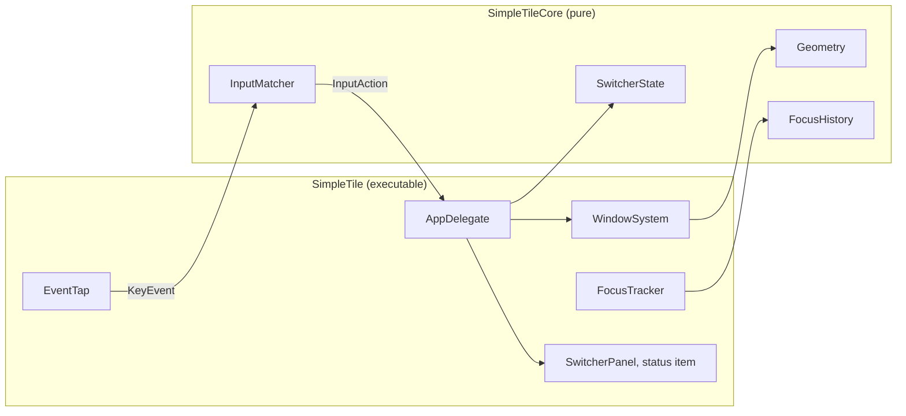
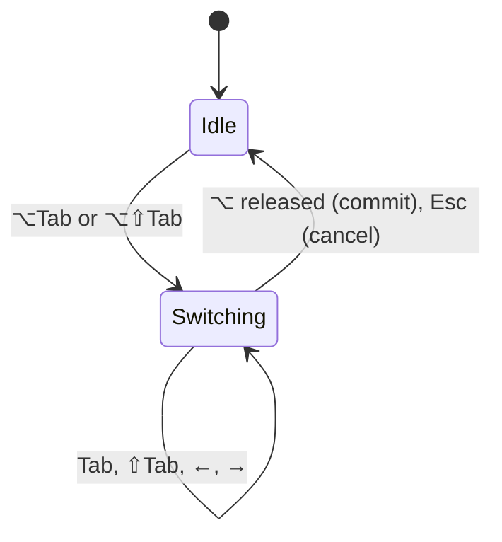

# 3. Architecture and design

How the app is structured to meet [Functionality](01-functionality.md) with the [Technology stack](02-technology-stack.md).

## Core idea: pure decisions, thin shell

Decisions that don't need macOS live in `SimpleTileCore` and are tested there: which keys trigger what, where a tiled window goes, switcher selection and ordering. The `SimpleTile` executable is the shell: it reads the world through AX, feeds the core, and applies the results. There is no central engine. The app delegate calls the core pieces directly.



## Core components

### InputMatcher

Turns raw key events into actions, and tells the event tap whether to swallow each event. It runs on the event tap thread, so it is synchronous and allocation-light.

```swift
struct KeyEvent { let kind: Kind; let keyCode: UInt16; let modifiers: Modifiers }  // kind: keyDown, keyUp, flagsChanged

enum InputAction { case tile(TileTarget), switcher(SwitcherAction) }   // SwitcherAction: open, next, previous, commit, cancel

struct InputMatcher {
    mutating func handle(_ e: KeyEvent) -> Result   // (actions: [InputAction], swallow: Bool)
}
```

States:



- In `Idle`, ⌥⌃←, ⌥⌃→, ⌥⌃↑ and ⌥Tab keyDowns are matched and swallowed. The matching keyUp is swallowed too, so apps never see half a keystroke.
- In `Switching`, Tab, ⇧Tab, arrows and Esc are matched and swallowed. Other keys pass through.
- Any event without ⌥ while switching commits first. This covers a missed ⌥ release when the tap was briefly disabled.
- `flagsChanged` events are never swallowed.
- `Modifiers` keeps only ⇧, ⌃, ⌥ and ⌘. Arrow keys also carry the fn and numeric pad flags, which would otherwise break matching.
- Key codes are physical (`kVK_*`), so shortcuts work on any keyboard layout.

### Geometry

- One coordinate system in the core: AX global coordinates, origin at the top-left of the main display, y grows downward. `axRect(fromAppKit:primaryDisplayHeight:)` converts `NSScreen` frames (bottom-left origin). It is the only conversion.
- `tile(_:in:)`: halves and full rect of a usable frame. Odd widths: the left half gets the extra point.
- `bestArea(for:among:)`: index of the area that overlaps a window the most. Picks the display a window is tiled on.

### SwitcherState and FocusHistory

- `WindowID`: opaque integer minted by the shell.
- `FocusHistory`: window IDs, most recently focused first. `ordered(_:)` sorts a list of present windows by it, with never-focused windows after, in the given order (SW-2). Closed windows drop out because they are not in the list passed in.
- `SwitcherState`: the entry list, frozen at open, and the selected index. The initializer fails with no entries (SW-7) and selects index 1, or index 0 with a single entry (SW-3). `next` and `previous` wrap (SW-4).

## Shell components

### WindowSystem

Bridges the Accessibility API on the main actor.

- AX calls run synchronously on the main thread with a 0.5 s messaging timeout, so a hung app stalls the UI for at most that long per call.
- Keeps `WindowID <-> AXUIElement`. IDs are minted on first sight. Equality uses `CFEqual`. Entries for windows missing from an enumeration are dropped.
- `standardWindows()`: standard, non-minimized windows of regular apps, excluding SimpleTile itself (AX calls to your own process deadlock).
- `tileFocusedWindow(_:)`: ignores the call when SimpleTile is frontmost, nothing is focused, or the window is fullscreen (TIL-5). Picks the usable area with `bestArea`, falling back to the main display.

Frame changes (`setFrame`):
- The app's `AXEnhancedUserInterface` attribute is turned off for the move, then restored. When it is on (VoiceOver and some other assistive tools enable it), many apps animate every AX move. This is a public attribute, though undocumented. Rectangle, yabai and AeroSpace use the same trick.
- Size, then position, then size again. Some apps clamp size to the screen the window is currently on (TIL-4).

Focus (`focus(_:)`):
- Set `AXMain` on the window and perform `kAXRaiseAction`. Then hand activation over cooperatively: `NSApp.activate()`, `NSApp.yieldActivation(to:)`, `target.activate(from: .current)`. A plain `activate()` from our inactive app is ignored, and `AXFrontmost` raises every window of the app. Measured in [spikes](spikes.md).

### FocusTracker

Feeds `FocusHistory`:
- `NSWorkspace.didActivateApplicationNotification`: records the frontmost app's focused window.
- One `AXObserver` per regular app for `kAXFocusedWindowChangedNotification`, on the main run loop. Observers are added at start and on app launch, and removed on app terminate.
- The app delegate also records the window it focuses on switcher commit, so the history is right even if a notification is late.

### EventTap

- A `CGEventTap` at session level on a dedicated thread, for `keyDown`, `keyUp` and `flagsChanged`.
- Calls `InputMatcher` synchronously and returns `nil` to swallow. Actions go to the main actor asynchronously, so the callback stays fast.
- Re-enables itself on `tapDisabledByTimeout` and `tapDisabledByUserInput`.

### AppDelegate

- Lifecycle: quits if another instance with the same bundle identifier runs (APP-4). Sets up the status item, then checks `AXIsProcessTrustedWithOptions` with the prompt option. If not trusted, shows the waiting item and polls every second until trusted (APP-3). macOS has no public notification for this. Once trusted, starts `FocusTracker` and `EventTap`.
- Tiling: forwards `tile` actions to `WindowSystem`.
- Switcher: on `open`, enumerates windows, orders them by `FocusHistory`, and creates `SwitcherState`. The panel is shown after 100 ms, only if the same switcher session is still open, so a quick ⌥Tab never flashes it. On `commit`, focuses the selection.
- Status item: SF Symbol `rectangle.split.2x1`. Launch at Login uses `SMAppService.mainApp`. Its state is read each time the menu opens, since it can also change in System Settings. If registration needs approval, the Login Items pane opens. Errors show an alert.

### SwitcherPanel

Borderless `NSPanel` with `.nonactivatingPanel`, level `.popUpMenu`, `collectionBehavior` `[.canJoinAllSpaces, .fullScreenAuxiliary, .transient]`, dark appearance. Tiles of 128 × 116 pt with a 64 pt icon and a two-line title, in a grid up to 90% of the main display's width. Rebuilt on every `show`. `select` only changes the highlight.

## Concurrency

| Thread | Runs | Talks to |
|---|---|---|
| Main actor | AppDelegate, WindowSystem, FocusTracker, AX observers, UI | Everything |
| Event tap thread | `CGEventTap`, `InputMatcher` | Main actor (actions, asynchronously) |

The matcher is owned by the event tap thread. Nothing else is shared.

## Logging

`os.Logger`, subsystem `simpletile`. Event tap creation and Launch at Login failures are logged at error level. `log stream --predicate 'subsystem == "simpletile"'` shows them.

## Source layout

```
Package.swift
Resources/Info.plist
Sources/
  SimpleTileCore/   Geometry, InputMatcher, Switcher (WindowID, SwitcherState, FocusHistory)
  SimpleTile/       main, AppDelegate, EventTap, WindowSystem, FocusTracker, SwitcherPanel, AXElement
Tests/
  SimpleTileCoreTests/
scripts/
  bundle.sh
  install.sh
docs/
```

## Lessons from AeroSpace

Read from the AeroSpace source at commit `6ed6af6` (2026-11-13). AeroSpace is MIT licensed. We reuse ideas, not code.

| What AeroSpace does | Where | Adopted |
|---|---|---|
| Turns off `AXEnhancedUserInterface` during moves to stop app animations | `MacApp.disableAnimations` | Yes |
| Focus: set `AXMain`, raise, then activate the app | `MacApp.nativeFocus` | Yes, with cooperative activation |
| Size, then position, then size | `MacApp.setFrame` | Yes |
| Ignores itself | `MacApp.getOrRegister` | Yes |
| One thread with a run loop per app for all AX calls | `tree/MacApp.swift` | No. A short timeout on the main thread is enough for tiling and the switcher. |
| `_AXUIElementGetWindow` for stable window IDs | `PrivateApi` | No, against our public-API principle |
